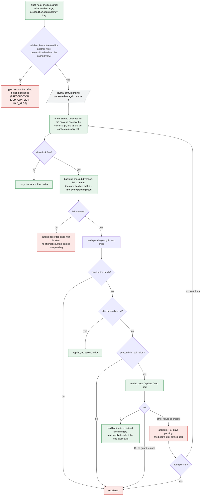
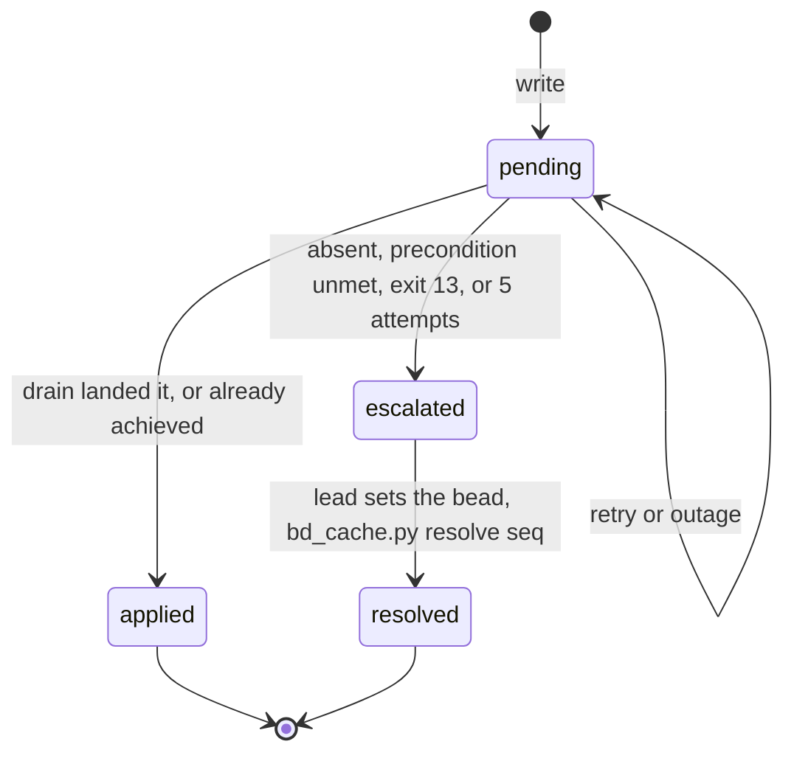
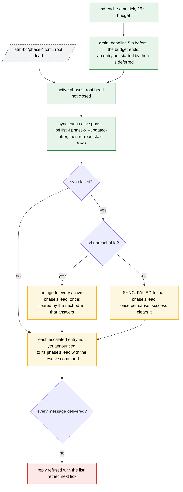

# bd-cache: reads, journaled writes, drain, sync and outage

One SQLite file per dolt database, `.atm-bd/<dolt_database>.bd-cache.sqlite3`
(ignored), holds cached bead rows and a journal of bead writes. The close
hooks and close scripts read from it and write to its journal; only the drain
calls `bd` to apply a write. Every path ends applied, refused or escalated to
the phase lead. The contract is `scripts/BD-CACHE.md`.

## Write and drain

A read (`get`) returns the cached row with that bead's pending entries
replayed on top; a miss makes one `bd list --id` call. Agents' own `bd show`
and `bd ready` read bd directly, so they see a journaled write only once the
drain applies it: under a second normally, at most one cron tick. For the
sanity hook the lag delays work and never releases it early.

## Journal entry states

An escalated entry is no longer replayed on reads. `status` and the cron's
`doctor` list it until it is resolved. `prune --phase x` is refused while the
phase has pending or escalated entries.

## Cron tick, sync and outage

An outage counts no attempt, so a long bd stall escalates nothing by itself;
a reachable bd that refuses or fails a write still counts toward the five
attempts. A passing `bd version` does not clear an outage. Messages go to
`<lead>@<team>` from the cron, through `atm send`.
