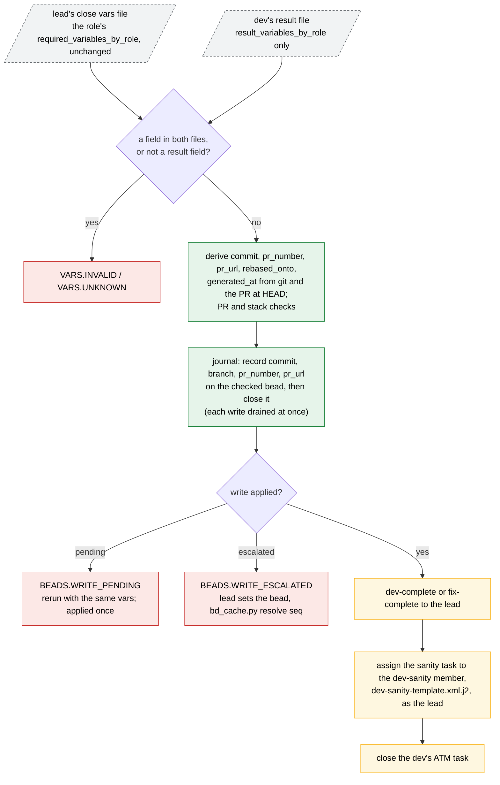
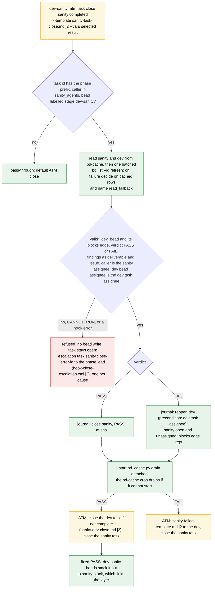
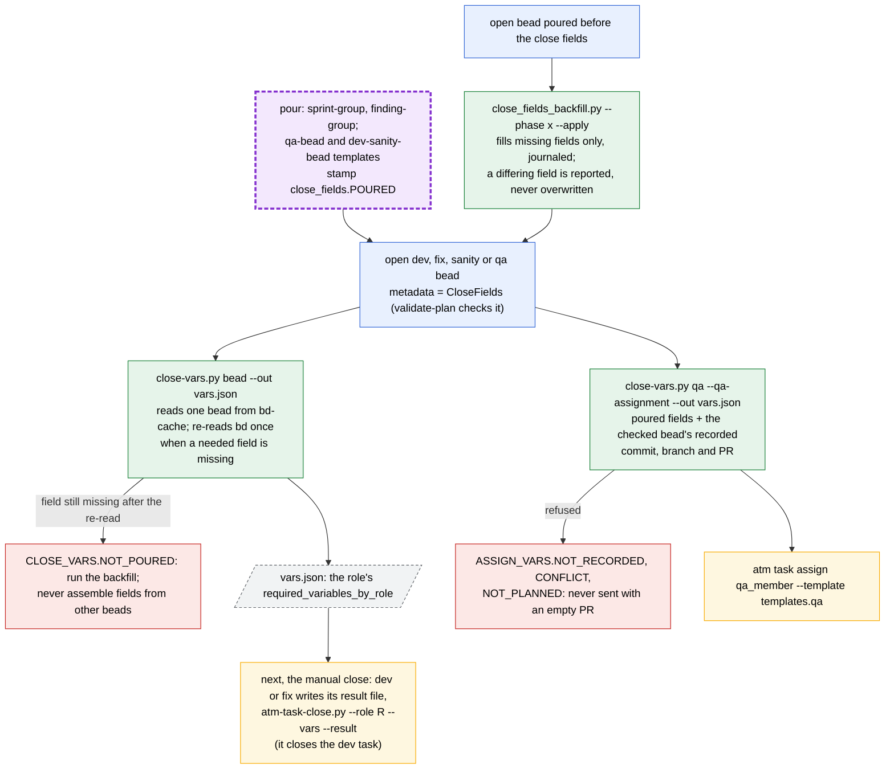

# Task close: close script, sanity hook and close vars

A task closes through one of two package scripts, and both write beads only
through the bd-cache journal (bd-cache.md):

| Role | Close | Run by |
| --- | --- | --- |
| dev, fix | `atm-task-close.py --role dev\|fix --vars <close vars> --result <result>` | the dev |
| sanity | `atm task close <sanity> completed --template sanity-task-close.md.j2 --vars <selected result>`, handled by the ATM `task.close` hook `sanity_task_close_hook.py` | dev-sanity; the hook runs in the daemon |
| qa | `atm-task-close.py --role qa --vars <close vars>`, after the fix groups are poured | quality-mgr |

The sanity hook is registered per phase from the primary checkout
(`atm hook register task.close --phase <x> --cwd . --module ... --custom
'{"task_prefix": ..., "sanity_agents": [...]}'`) and disabled with
`atm hook disable --phase <x> task.close`. It runs under a 2.5 s budget.

## Dev or fix close

The dev never types the derived fields and never adds fields to the lead's
file.

## Sanity close hook

All validation comes before the first journal write. Each write's
idempotency key comes from the close plan, so a retried close journals
nothing twice. The hook returns its ATM actions once the writes are
journaled; a slow or failing bd never holds the task open, and a write the
drain cannot apply is escalated by the bd-cache cron (bd-cache.md). The owner
of a refusal is named in it: sanity for an invalid result, the phase lead for
missing planning data, the hook maintainer for a module defect.

The hook neither dispatches QA nor links the stack. Once the drain has
applied the PASS, the qa bead is in `bd ready`, and the lead builds its vars
with `close-vars.py <qa bead> --qa-assignment` (below) and runs the
`atm task assign` it prints. On FAIL the lead re-assigns the dev's task; the
dev fixes, rebases, pushes and runs `atm-task-close.py` again.

### Legacy sanity close

A phase without the hook registration closes sanity with `sanity-close-vars`
and `atm-task-close.py --role sanity` (assignment `sanity_close_mode` =
`legacy`). PASS closes the sanity bead and task and assigns QA itself. FAIL
increments `metadata.sanity_round`; while it is at most `max_sanity_rounds`
it reopens the checked bead, resets sanity open and unassigned and sends
`sanity-fail`; above the cap it sends `SANITY.ROUND_CAP` to the lead and
reopens nothing.

## Close vars

Every open task bead carries the fields its close needs from the pour, so a
close reads one bead. A sanity close adds its round (the task's `started`
events) and its QA bead's `reviewers_round1`; a QA close adds its round. The
console's automatic QA dispatch builds its vars with the same resolver,
`close_fields.qa_assignment_vars`.
