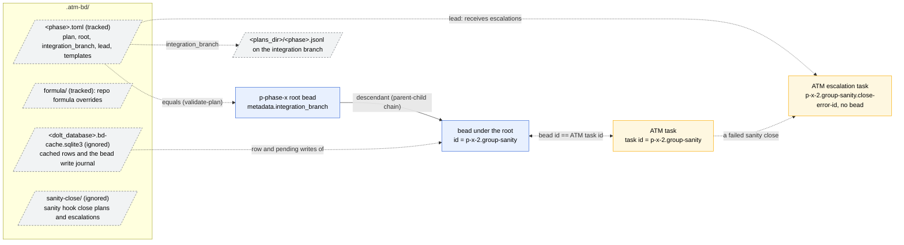

# Correlation: beads, ATM tasks and the current phase

Tracked `.atm-bd/<phase>.toml` names the plan file, the phase root, the
integration branch, the phase lead and the assignment template for each
purpose (`[templates]`: `dev`, `fix`, `sanity`, `qa`, `plan_review`,
`review`); `validate-plan` checks that the integration branch equals the
root's `metadata.integration_branch`. The close hooks and the bd-cache cron
send their escalations to that `lead`.
Work is assigned with `atm task assign <member> --task-id <bead id>`; the lead
picks the agent at dispatch. The sanity task is the exception: the dev's
close script assigns it, as the lead, to the dev-sanity member.

| Bead | ATM task held by | Assigned by, template |
| --- | --- | --- |
| dev | a dev, by `difficulty` | the lead, `templates.dev`; a sanity FAIL reopens the same bead and the lead re-assigns the same task, with no new template. The sanity close hook (`sanity_task_close_hook.py`) journals the reopen through the bd-cache and sends the dev `sanity-failed-template.md.j2`; a legacy-mode close (`atm-task-close.py --role sanity`) sends `sanity-fail.xml.j2` |
| fix | a dev, by `difficulty` | the lead, `templates.fix` |
| sanity | dev-sanity | `atm-task-close.py` at dev or fix close, `dev-sanity-template.xml.j2` |
| qa | quality-mgr | the lead, `templates.qa`, vars from `close-vars.py --qa-assignment` |
| important or minor finding | an idle dev, by priority | the lead, `templates.fix` |
| sprint container | none; the team lead closes it | none |
| none: `<sanity task>.close-error-<id>` | the phase lead | the sanity close hook, `hook-close-escalation.xml.j2`, one per cause |
