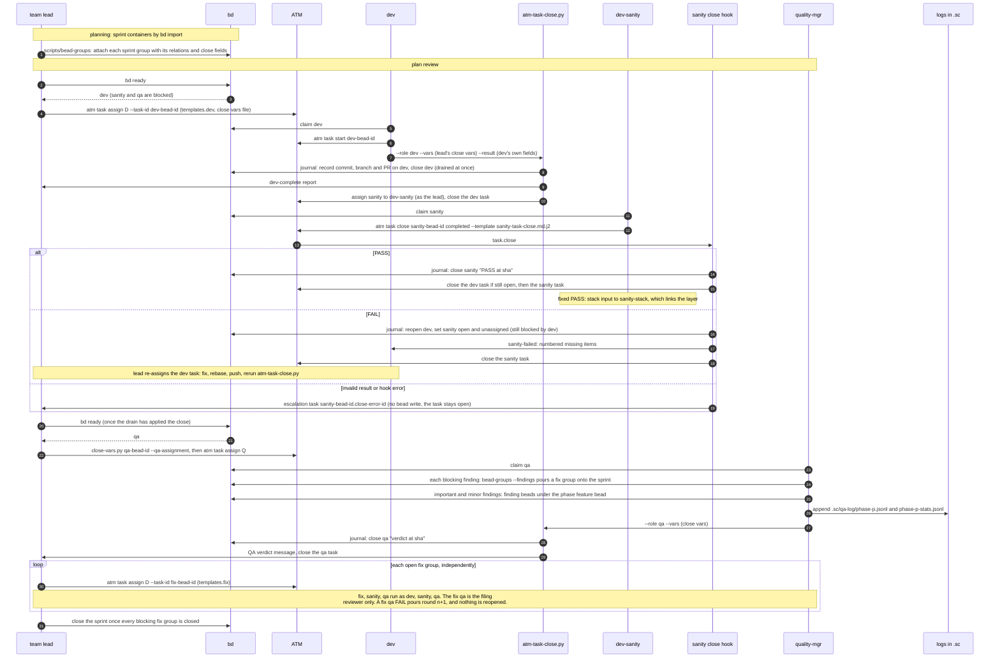

# Lifecycle (sprint level)

Each ATM task id equals its bead id (correlation.md). The close script and
the hook write beads only through the bd-cache journal (bd-cache.md); `bd
ready` sees a write once the drain applies it, normally under a second. The
close paths in detail, and where the close vars come from, are in
close-hooks.md.

This is the daemon close mode: the phase registers the sanity `task.close`
hook and the sanity assignment's `sanity_close_mode` is `daemon`. In the
legacy mode (no registration) dev-sanity closes with `sanity-close-vars` and
`atm-task-close.py --role sanity`, which on PASS also assigns QA and on FAIL
counts rounds (close-hooks.md, "Legacy sanity close").

| Fact | Where it is written |
| --- | --- |
| close fields | every open dev, fix, sanity and qa bead's metadata, from the pour (`CloseFields`) |
| recorded close | the checked bead's `metadata.commit`, `branch`, `pr_number`, `pr_url`, by `atm-task-close.py`; QA vars are built from them |
| sanity result | sanity bead `close_reason` "PASS at sha"; FAIL reopens the checked bead and sends the numbered missing items through `sanity-failed`, without finding children |
| QA verdict | qa bead `close_reason` "verdict at sha" |
| round | `metadata.round` on qa and fix beads |
| severity | `metadata.severity` on fix and finding beads |
| bead writes from a close | bd-cache journal `.atm-bd/<dolt_database>.bd-cache.sqlite3` |
| sanity hook close plans and escalations | `.atm-bd/sanity-close/journal.sqlite3` |

quality-mgr appends `.sc/qa-log/phase-
.jsonl` and
`.sc/qa-log/phase-
-stats.jsonl` when it closes qa. In the legacy close
mode dev-sanity also appends the sanity ledger `.sc/sanity-log/phase-
.jsonl`
with `sanity-run-history`: two rows per run, one for LLM and one for JEV,
sharing a `run_id` and the final verdict.
