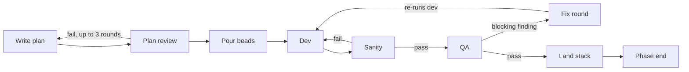

# Getting going with atm-bd

A plain-language guide for people who drive the work by asking Claude or Codex to do tasks. For exact settings and options, see the [console README](../apps/atm-bd-console/README.md) and the [plugin README](../plugins/atm-bd-orchestration/README.md).

## What atm-bd is

atm-bd runs a team of AI agents through a planned phase of work, and gives you a dashboard to watch it. You steer by asking Claude or Codex to do things; the agents pass work to each other through ATM messages and beads.

- **Beads** are the to-do items. Each sprint becomes a group of beads: dev, then sanity, then QA. `bd ready` lists what can start now.
- **ATM** is the mail system the agents use to assign and close tasks.
- **The skills** (`atm-beads`, `atm-bd-orchestration`) teach each agent its job. They are installed into the repo.
- **The console** (`atm-bd console`) shows the phase live and sends sanity and QA work out on its own when it's ready.



The next sprint's dev starts as soon as this one's sanity passes; it doesn't wait for QA.

| Role | What it does |
| --- | --- |
| Lead | Runs the phase: dispatches ready work, owns the PR stack and the merge, makes the calls, escalates to you |
| Planner | Turns a design into the phase plan |
| Dev | Builds one bead on its own branch and opens a PR |
| Dev-sanity | Checks every promised deliverable exists and lint passes; not a quality review |
| Quality-mgr | Runs QA, plan review and the phase-end review through a panel of reviewers |
| `atm-bd@tool` | The console's sender address, not an agent |

The lead does not write code. If you find it implementing, that's a stall.

## One-time machine setup

You need eight command-line tools and two Python packages. Check them once per machine.

| Tool | Why | Install | Check |
| --- | --- | --- | --- |
| `atm-bd` | The console and the skill installer | `uv tool install atm-bd` | `atm-bd --version` |
| `atm` | Agent messaging and task assignment | Homebrew | `atm --version` |
| `bd` | Beads, the issue tracker the work runs on | Homebrew | `bd --version` |
| `dolt` | The database behind beads, run as a server | Homebrew | `which dolt` |
| `git` | Branches and worktrees | Homebrew | `git --version` |
| `gh` | Reads pull requests from GitHub | Homebrew, then `gh auth login` | `gh auth status` |
| `jq` | Used by the installed scripts | Ships with macOS | `jq --version` |
| `sc-compose` | Renders templates during install; needs 1.7.0 or newer | `brew update`, then `brew install randlee/tap/sc-compose` | `sc-compose --version` |

The host Python also needs these packages, because the installed scripts run with plain `python3`:

```bash
python3 -m pip install pydantic pyyaml 'sc-compose>=1.7.0,<2'
```

The Python package must be the same version as the `sc-compose` CLI; the installer checks both. Keep `atm-bd` current with `uv tool upgrade atm-bd`.

## One-time repo setup

Each repo your agents work in needs four things in place before `atm-bd skill` will install. Ask Claude to check and create them, then run the installer.

- [ ] A git `origin` on GitHub.
- [ ] Beads in server mode: `.beads/metadata.json` has `"dolt_mode": "server"`.
- [ ] `.atm.toml` at the repo root, with the team name under `[atm]` as `default_team`.
- [ ] `.claude/agents/registry.yaml` naming the team's agents and the install variables. Any it lacks can be passed as `--set name=value`.
- [ ] Run `atm-bd skill` from the repo root.

The installer does three things:

1. It copies the orchestration skills and templates into `.claude/` (or `.codex/` with `--codex`).
2. It writes the team's settings to `.claude/project/atm-bd-orchestration.yaml`.
3. It adds the `atm-bd@tool` member to the team, which the console sends notices from.

A prompt that works: *"Check this repo is ready for atm-bd skill, list what's missing, then install it."*

## Starting a phase

A phase starts from a design and ends when its plan has passed review and its beads are poured. Name it with a short lowercase id, like `bk`. Hand this whole list to the planner in one ask; you approve the plan review.

1. **Create the phase file.** `.claude/skills/atm-beads/scripts/phase-config init --phase <x> --lead <member>` writes `.atm-bd/phase-<x>.toml`.
2. **Write the plan.** It lives at `<plans_dir>/phase-<x>.jsonl`: one line per sprint, with what it depends on. Everything else about a sprint lives in its beads.
3. **Validate it.** `validate-plan --phase <x>` must pass. Never edit the plan or the script just to make it pass.
4. **Import and pour.** `bd import`, then `bead-groups --phase <x>` creates the dev, sanity and QA beads for each sprint.
5. **Review the plan.** Quality-mgr reviews it, for up to three rounds. No dev work starts until it passes.
6. **Commit** the plan and phase file to the integration branch.

A prompt that works: *"Use atm-beads to turn docs/design/x.md into a phase plan for phase bk with solar as lead, validate it, pour the beads, and send it for plan review."*

To bring in a plan you already wrote in markdown, ask Claude to follow `importing-md-plan.md`.

## Day to day: what to ask Claude or Codex

Ask the lead's session; it holds the phase and hands work out. Name the skill when you can, so the agent loads the right instructions.

| You want | Ask |
| --- | --- |
| Keep work moving | "Using atm-bd-orchestration, run the loop for phase bk: check bd ready and dispatch what's ready." |
| Know where things stand | "Run sprint-report for phase bk." |
| See the dependency graph | "Run sprint-review for phase bk and show me the DAG." |
| See QA results | "Run /qa-report and show the last 20 rows." |
| Find out why a plan fails | "Run validate-plan --phase bk and tell me what's wrong." |
| Land finished work | "Use sc-gh-stack to land the phase bk stack." (lead only) |
| Finish the phase | "Run the phase-end review and post-mortem for phase bk." |

Three rules the agents follow, so you don't have to ask for them:

- A bead is only dispatched once `bd ready` lists it.
- A task closes only through its close template; a push or a progress note closes nothing.
- A missing tool, wrong identity or `bd doctor` error means stop and report, never work around it.

## Watching the work with the console

Start the console from the repo root in its own terminal pane, and leave it running. It refreshes every 60 seconds and hands out sanity and QA work as soon as it's ready.

```bash
cd <repo>
atm-bd queues --phase bk --all        # quick check that the setup reads cleanly
atm-bd console --phase bk --dry-run   # first run: shows what it would do, sends nothing
atm-bd console --phase bk             # the real thing
```

- `--github off` stops it reading pull requests, which saves GitHub quota.
- `atm-bd show --phase bk` prints the last saved picture without starting anything.
- Defaults for these options can live in `.atm-bd/console.toml`, under `[console]`.

Run it from the repo root exactly; it fails from a subfolder.

## When something goes wrong

Every error names the setting or tool at fault, so paste it to Claude and ask for the fix. The common ones:

| You see | It means | Fix |
| --- | --- | --- |
| `--phase <phase> is required` | No phase given | Add `--phase <x>`; lowercase letters and digits only |
| `config_invalid: set lead in .atm-bd/phase-<x>.toml` | The phase file is from an older version | Add `lead = "<member>"` and a `[templates]` table, or recreate it with `phase-config init` |
| `config_invalid` naming `dev_fix` or another template | A template entry is wrong | Keep exactly six: dev, fix, sanity, qa, plan_review, review |
| `not_found: install atm-bd-orchestration` | No settings file for the team | Run `atm-bd skill` in the repo |
| `not_found: install bd` (or atm, git) | A tool is missing from PATH | Install it (see machine setup) |
| `not_found` with an `atm teams add-member` hint | The console's sender isn't on the team | Run the command it prints |
| `io_failed` on `.atm.toml` | You launched from a subfolder, or the file is missing | `cd` to the repo root |
| GitHub quota paused in the status bar | The GraphQL quota ran low | Wait for the reset it shows, or use `--github rest` |

The console only reads files in the folder you start it from; it does not look in parent folders.
