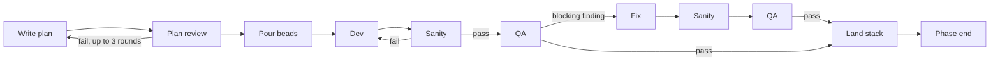

# Getting going with atm-bd

A plain-language guide for people who drive the work by asking Claude or Codex to do tasks. For exact settings and options, see the [console README](../apps/atm-bd-console/README.md) and the [plugin README](../plugins/atm-bd-orchestration/README.md).

## What atm-bd is

atm-bd runs a team of AI agents through a planned phase of work, and gives you a dashboard to watch it. You steer by asking Claude or Codex to do things; the agents pass work to each other through ATM messages and beads.

- **Beads** are the to-do items. Each sprint becomes a group of beads: dev, then sanity, then QA. `bd ready` lists what can start now.
- **ATM** is the mail system the agents use to assign and close tasks.
- **The skills** (`atm-beads`, `atm-bd-orchestration`) teach each agent its job. They are installed into the repo.
- **The console** (`atm-bd console`) shows the phase live and sends QA work out on its own when it's ready. Sanity work is sent by the dev's own close, not by the console.



The next sprint's dev starts as soon as this one's sanity passes; it doesn't wait for QA. A blocking QA finding gets its own fix, sanity and QA beads under the same sprint; the sprint's dev bead does not run again.

| Role | What it does |
| --- | --- |
| Lead | Runs the phase: dispatches ready work, owns the PR stack and the merge, makes the calls, escalates to you |
| Planner | Turns a design into the phase plan |
| Dev | Builds one bead on its own branch and opens a PR |
| Dev-sanity | Checks every promised deliverable exists and lint passes; not a quality review |
| Quality-mgr | Runs QA, plan review and the phase-end review through a panel of reviewers |
| `atm-bd@tool` | The sender address of the console and the bd-cache cron, not an agent |

The lead does not write code. If you find it implementing, that's a stall.

## One-time machine setup

You need these command-line tools and three Python packages. Check them once per machine. The installer refuses to run when a tool it checks is missing or older than the version shown.

| Tool | Why | Needs | Install | Check |
| --- | --- | --- | --- | --- |
| `python3` | Runs the installed scripts | 3.11 or newer | your system package manager | `python3 --version` |
| `atm-bd` | The console and the skill installer | 0.19.2 for these steps | `uv tool install atm-bd` | `atm-bd --version` |
| `atm` | Agent messaging, task assignment, hooks and crons | 1.6.3 or newer | the GitHub prerelease from [randlee/atm-core](https://github.com/randlee/atm-core/releases) until a stable release has `atm hook`; `brew install randlee/tap/atm` gives 1.6.1, which lacks `atm hook` and `atm cron` | `atm --version`, `atm hook --help` |
| `bd` | Beads, the issue tracker the work runs on | 1.3.0 or newer | `brew install beads` | `bd --version` |
| `dolt` | The database server behind beads (server mode) | not checked | Homebrew | `which dolt` |
| `git` | Branches and worktrees | 2.27 or newer | `brew install git` | `git --version` |
| `jq` | Used by the installed scripts | 1.6 or newer | ships with macOS 15 and later; otherwise `brew install jq` | `jq --version` |
| `sc-compose` | Renders templates during install | 1.7.0 or newer, below 2 | `brew update`, then `brew install randlee/tap/sc-compose` | `sc-compose --version` |
| `gh` | Reads pull requests from GitHub | not checked | Homebrew, then `gh auth login` | `gh auth status` |
| `gh-stack` | The `gh stack` extension the lead uses to land the stack | not checked | `gh extension install github/gh-stack` | `gh stack --version` |

`gh` and `gh-stack` are not checked by the installer, but the orchestration skill checks both before it starts.

atm-bd 0.19.2 is the first release that adds the dev-sanity member and lists its changes when it installs. With 0.19.1, add the dev-sanity member by hand (see "Setting up the team").

The host `python3` also needs pydantic, PyYAML and the sc-compose wheel, because the installed scripts run with plain `python3`. The wheel must be the same version as the `sc-compose` CLI; the installer checks both and refuses a mismatch. Pin it to the CLI's version:

```bash
python3 -m pip install pydantic pyyaml "sc-compose==$(sc-compose --version | awk '{print $NF}')"
```

`atm-bd` carries its own copy of the sc-compose wheel, inside its uv tool environment, and the installer checks that one against the CLI too ("the installer interpreter wheel"). When they differ, reinstall `atm-bd` with the CLI's version:

```bash
uv tool install --force atm-bd --with "sc-compose==$(sc-compose --version | awk '{print $NF}')"
```

Keep `atm-bd` current with `uv tool upgrade atm-bd`, and run the reinstall above again after you upgrade `sc-compose`.

Jev, the reviewer service behind half of each sanity check and the phase-end post-mortem, needs `TYPESAFE_API_KEY` in the environment of the dev-sanity and quality-mgr agents. Without it the Jev half of every sanity check is unavailable, and the phase-end review cannot complete: its check refuses a post-mortem whose Jev status is `unavailable`. Once the repo is installed, check the key with `.claude/skills/atm-bd-orchestration/scripts/jev_client.py --startup`.

## One-time repo setup

Each repo your agents work in needs these in place. Ask Claude to check and create them, then run the installer.

The installer checks:

- [ ] A git `origin` with an `owner/name` URL. The console also needs it to be on GitHub.
- [ ] Beads in server mode: `.beads/metadata.json` has `"dolt_mode": "server"`. Start a `dolt sql-server`, then run `bd init --server --prefix <prefix>` in the repo (`bd init --help` lists the host, port and user options). `bd sync` only works once the database has a Dolt remote: `bd dolt remote add origin <url>`. Without one, every agent on this machine still shares the one server; there is just no off-machine copy.
- [ ] `.claude/agents/registry.yaml` naming the team's agents and the install variables. Any it lacks can be passed as `--set name=value`. See the example below.
- [ ] `.claude/agents/<name>.md` for each agent named in `qa_member` and `reviewers_round1`. Agents the package ships count.

The installer does not check these, but the console or the agents need them:

- [ ] `.atm.toml` at the repo root, with the team name under `[atm]` as `default_team`.
- [ ] These lines in `.gitignore`, for the files 0.19.0 writes: `.atm-bd/sanity-close/`, `.atm-bd/*.bd-cache.sqlite3*` and `.atm-bd/*.bd-cache.drain.*`.
- [ ] The file `policy_path` names (your repo's QA policy). QA and the dev templates read it.
- [ ] The agents and skills the work needs that atm-bd does not ship:
  - `.claude/agents/quality-mgr.md`;
  - an agent file for every name in `reviewers_round1`;
  - `req-qa`, `arch-qa`, `plan-scope-reviewer` and `ceremony-finding-screen`, which every plan review runs;
  - the `sc-gh-stack` and `sc-gh-stack-view` skills. The dev's close carries `/sc-gh-stack-view` output, and the lead lands the stack with `sc-gh-stack`.

  The two skills come from the `sc-gh-stack` package on [synaptic-canvas](https://github.com/randlee/synaptic-canvas): in Claude Code, run `/sc-manage --install sc-gh-stack --local` (`--global` puts it in `~/.claude` instead). `sc-manage` is itself a synaptic-canvas package; its README installs it with `python3 tools/sc-install.py install sc-manage --dest ~/.claude` from a synaptic-canvas checkout.

  Language "team" packages are planned to provide the reviewer agents, a Rust team first. Until they exist, the repo must supply them itself.

A `registry.yaml` with every key the installer needs (the values are examples):

```yaml
bead_prefix: myp
worktree_base: ../my-repo-worktrees
test_command: just test
lint_command: just lint
integration_branch_pattern: integrate/phase-{phase}
plans_dir: docs/plans
requirements_globs: [docs/requirements.md]
adr_globs: ["docs/adr/*.md"]
policy_path: .claude/project/quality-policy.md
reviewers_round1: [req-qa, arch-qa]

roles:
  lead: team-lead
  quality-mgr: quality-mgr
  dev-sanity: myp-sanity
```

`max_sanity_rounds` is optional (default 5). The plugin README's "Configuration" table explains each key.

Then:

- [ ] Run `atm-bd skill` from the repo root.

Upgrading a repo from 0.18.x to 0.19.x: rerun `atm-bd skill`, add the `.gitignore` lines above, and for each active phase do step 7 of "Starting a phase" (the hook and the crons). Then run `.claude/skills/atm-bd-orchestration/scripts/close_fields_backfill.py --phase <x> --apply --actor <your identity>` once for each active phase, so its open beads pass validation. Without `--apply` it only reports what it would change. `--actor` defaults to `ATM_IDENTITY` and is required with `--apply`. `--apply` only queues the writes; the bd-cache cron applies them on its next tick, or apply them at once with `.claude/skills/atm-bd-orchestration/scripts/bd_cache.py drain`.

The installer does these things:

1. It copies the orchestration skills and templates into `.claude/` (or `.codex/` with `--codex`).
2. It writes the team's settings to `.claude/project/atm-bd-orchestration.yaml`, writes the role members back into `roles:` in `registry.yaml`, and records every file it wrote in `.claude/project/atm-bd-orchestration.lock.json`. `atm-bd skill` also writes an install record, `.claude/atm-bd-install.json`.
3. It adds the `atm-bd` member to the separate ATM team `tool` (not your team), which the console and the bd-cache cron send notices from as `atm-bd@tool`. If it can't, the install stops with the command to run.
4. For a `.claude` install, it adds the dev-sanity member (`roles.dev-sanity` in `registry.yaml`) to your team as a Claude Code agent on sonnet, if the team doesn't have it yet. If it can't, the install still finishes and prints `NOT DONE:` with what to do, usually the exact `atm teams add-member` command to run.

In 0.19.2, when it finishes, `atm-bd skill` lists every change it made: the files written, removed or backed up, the roles it set, and the members it added. It also prints the `NOT DONE:` lines and the recommended `.atm.toml` block below.

A member's name only has to be unique in its team, like `team-lead`. Herdr finds an agent by its alias, like `atm-lead`, or by its member name when it has no alias, and that name must be unique on the computer: agents with the same name on one machine can't be told apart. So give the dev-sanity member a name or alias no other member on the computer uses, like `<repo>-sanity` (`rap-sanity` for raptor). The installer reads the alias from the member's `[[rmux.windows.panes]]` entry in `.atm.toml`, compares it (or the member name, when there is no alias) with the alias-or-name of every other member of every team on the computer, and refuses to add a name that is taken. The herdr agent must have that same name (`herdr agent rename <pane> <name>`), or nudges won't reach it.

The installer does not touch `.atm.toml`. When the file has no startup block for the dev-sanity member, the installer prints a recommended one under "Recommended addition to .atm.toml (not written)", filled in with your member and lead. We recommend adding it, so the agent reads its role sheet whenever it starts:

```toml
[startup.<dev-sanity-member>]
all = ["Your role is dev-sanity under atm-bd-orchestration: read .claude/agents/dev-sanity.md now (again after every compaction) and run its Startup section",
       "Use native atm send or atm ack for messages to <lead>",
       "Use native atm read to read messages from team-members" ]
```

A prompt that works: *"Check this repo is ready for atm-bd skill, list what's missing, then install it."*

To check an install later, run `.claude/skills/atm-bd-orchestration/scripts/atm-hook-doctor.py`; it compares the installed files with the install record.

## Setting up the team

Do this once per repo, after the install. Every agent is a member of your team (the `default_team` in `.atm.toml`).

Add each member: the lead, quality-mgr, each dev, and dev-sanity if the installer didn't:

```bash
atm teams add-member <team> <member> --agent-type <type> --model <model> \
  --home-dir <repo> --backend herdr --alias <host-unique name>
```

- The member name only has to be unique in the team; the alias must be unique on the computer, as for dev-sanity above. A pattern that works: member `team-lead`, alias `<repo>-lead`.
- Give devs `--agent-type dev`: `sprint-report --dispatch` recommends idle members of that type.
- Leave `--alias` off only when the member name is already unique on the computer.

Each agent's session needs three environment variables, set when you launch it (in its `[[rmux.windows.panes]]` entry's `env`, for example):

- `ATM_IDENTITY`: its member name, never the alias.
- `ATM_TEAM`: your team.
- `BEADS_ACTOR`: the same as `ATM_IDENTITY`.

Give each long-running agent a startup block in `.atm.toml`, so it reads its role whenever it starts. Replace `<lead>`, `<qa>` and the member names with yours:

```toml
[startup.<lead>]
all = ["Your role is lead under atm-bd-orchestration: read .claude/skills/atm-bd-orchestration/SKILL.md (Lead Role and Loop) and .claude/skills/atm-beads/SKILL.md now (again after every compaction); on each Loop pass run .claude/skills/atm-bd-orchestration/scripts/bead-queues --phase <x> and act on every row",
       "Use native atm send or atm ack for messages to team-members",
       "Use native atm read to read messages from team-members" ]

[startup.<qa>]
all = ["read .claude/agents/quality-mgr.md for directive",
       "Your role is quality-mgr under atm-bd-orchestration: read .claude/skills/atm-bd-orchestration/roles/quality-mgr.md now (again after every compaction); where it and quality-mgr.md differ, the role file wins",
       "Use native atm send or atm ack for messages to <lead>",
       "Use native atm read to read messages from team-members" ]

[startup.<dev>]
all = ["Your role is dev under atm-bd-orchestration: work arrives by atm task assign with the dev template; no user is watching, so execute every step through to the task close and never end a turn on a promise of future work",
       "Use native atm send or atm ack for messages to <lead> or <qa>",
       "Use native atm read to read messages from team-members" ]
```

The dev-sanity block is the one the installer recommends, shown above.

The bd-cache cron sends its notices as `atm-bd@tool`, the member the installer adds; there is no `cron` member to add. `cron@tool` is reserved by atm for its own scheduler, and atm refuses any other sender with that name.

## Starting a phase

A phase starts from a design and ends when its plan has passed review and its beads are poured. Name it with a short lowercase id, like `bk`. Hand this whole list to the planner in one ask; you approve the plan review.

Two files are easy to mix up. The **sprint index**, `<plans_dir>/phase-<x>.jsonl`, is committed: one line per sprint, with what it depends on. The **bead file**, `<scratch>/plan.jsonl`, holds the rendered beads you import; keep it outside the repo and never commit it. Everything else about a sprint lives in its beads.

1. **Create the phase file.** `.claude/skills/atm-beads/scripts/phase-config init --phase <x> --lead <member>` writes `.atm-bd/phase-<x>.toml`. It never overwrites an existing file. Check the paths and the integration branch it wrote.
2. **Create the integration branch** (the phase file's `integration_branch`) from your base branch and push it.
3. **Check beads.** Run `bd doctor --json`. Any check with `"status": "error"` stops the plan.
4. **Write the plan.**
   - Render the phase root (`plan-root.json.j2`), the stack bead (`stack-bead.json.j2`) and one sprint bead per sprint (`sprint-bead.json.j2`) from `.claude/skills/atm-beads/templates/`, each with `sc-compose render --strict`, into `<scratch>/plan.jsonl`. Example vars are in `.claude/skills/atm-beads/examples/`, and `.claude/skills/atm-beads/resources/planning.md` has the exact commands.
   - Write the sprint index `<plans_dir>/phase-<x>.jsonl`.
5. **Validate it before import.** `.claude/skills/atm-beads/scripts/validate-plan --file <scratch>/plan.jsonl --phase <x> --index <plans_dir>/phase-<x>.jsonl` must pass. Never edit the plan or the script just to make it pass.
6. **Import and pour.**
   - `bd import --dry-run -i <scratch>/plan.jsonl`, then `bd import -i <scratch>/plan.jsonl`.
   - `.claude/skills/atm-bd-orchestration/scripts/bead-groups --phase <x>` creates the dev, sanity and QA beads for each sprint.
   - Right away, create the plan-review bead and make every sprint wait on it: the commands are step 1 of "Plan Gate" in `.claude/skills/atm-bd-orchestration/SKILL.md`.
   - Then commit the sprint index and the phase file, and push them to the integration branch.
   - `.claude/skills/sprint-review/scripts/sprint-review --root <root>` draws the phase diagram locally.
   - `.claude/skills/atm-beads/scripts/validate-plan --phase <x>` checks the live beads. It reads the sprint index from the pushed integration branch, so it needs the push.
7. **Switch on the hook and the crons.** Run these from the repo root before dev work starts.
   - Register the sanity close hook, with `<prefix>` your bead id prefix and the `dev_sanity_member` from `.claude/project/atm-bd-orchestration.yaml`:
     `atm hook register task.close --phase <x> --cwd . --module .claude/skills/atm-bd-orchestration/scripts/sanity_task_close_hook.py --custom '{"task_prefix":"<prefix>-<x>-","sanity_agents":["<dev_sanity_member>"]}'`
   - Once the hook is registered, dev-sanity must close through it (the daemon close flow). In 0.19.2 the dev's close sets this on the sanity assignment (`sanity_close_mode`) by itself. With 0.19.1 the assignment still says `legacy`, so the lead tells the dev-sanity member once, by `atm send`, that the hook is on for phase `<x>` and to use the daemon flow (`.claude/agents/dev-sanity.md`, "Close first, then stack handoff").
   - Start the bd-cache cron, with the team from `.atm.toml`. It runs for the whole repo, and stops itself when no phase is active, so at each phase start check `atm cron list` and start it again when it isn't listed:
     `atm cron start bd-cache --phase <x> --cron "*/30 * * * * *" --until-hook --module .claude/skills/atm-bd-orchestration/scripts/bd_cache_cron.py --cwd . --custom '{"team":"<team>"}'`
   - Schedule `atm-bd cron --phase <x>` every 15 minutes while the phase runs. Each run is one console tick, so it dispatches ready QA work just as the console does. While a console is running, a cron run reports `lock_held` and does nothing. The plugin README's "Phase cron" section has crontab and Hermes examples.
   - The hook and the bd-cache cron change local ATM daemon state only; they commit nothing and dispatch nothing.
8. **Review the plan.** Quality-mgr reviews it, for up to three rounds. No dev work starts until it passes.

When the phase is done (or paused), turn things off: `atm hook disable --phase <x> task.close`, and remove the `atm-bd cron` entry from crontab or Hermes.

A prompt that works: *"Use atm-beads to turn docs/design/x.md into a phase plan for phase bk with `<lead>` as lead, validate it, pour the beads, and send it for plan review."*

To bring in a plan you already wrote in markdown, ask Claude to follow `.claude/skills/atm-beads/resources/importing-md-plan.md`.

## Who sends which work

- **The lead** sends plan review, dev and fix work by hand, with `atm task assign` and the phase file's templates. For each dev or fix bead, it also writes the close vars file the dev will need: `.claude/skills/atm-bd-orchestration/scripts/close-vars.py <bead> --out <path>`.
- **The dev's close sends sanity.** The dev finishes by running `.claude/skills/atm-bd-orchestration/scripts/atm-task-close.py` with that close vars file. It closes the dev bead and task and assigns sanity to the dev-sanity member. Without the close vars file, sanity is never assigned.
- **The console** (and the `atm-bd cron` tick) sends QA once sanity passes. It never sends sanity work.

## Day to day: what to ask Claude or Codex

Ask the lead's session; it holds the phase and hands work out. Name the skill when you can, so the agent loads the right instructions.

| You want | Ask |
| --- | --- |
| Keep work moving | "Using atm-bd-orchestration, run the loop for phase bk: check bd ready and dispatch what's ready." |
| Know where things stand | "Run sprint-report for phase bk." |
| See the dependency graph | "Run sprint-review for phase bk and show me the DAG." |
| See QA results | "Run /qa-report and show the last 20 rows." |
| Find out why a plan fails | "Run validate-plan --phase bk and tell me what's wrong." |
| Land finished work | "Use sc-gh-stack to land the phase bk stack." (lead only) |
| Finish the phase | "Run the phase-end review and post-mortem for phase bk." |

Three rules the agents follow, so you don't have to ask for them:

- A bead is only dispatched once `bd ready` lists it.
- A task closes only through its close template; a push or a progress note closes nothing.
- A missing tool, wrong identity or `bd doctor` error means stop and report, never work around it.

## Watching the work with the console

Start the console from the repo root in its own terminal pane, and leave it running. It refreshes every 60 seconds and hands out QA work as soon as it's ready.

```bash
cd <repo>
atm-bd queues --phase bk --all        # quick check that the setup reads cleanly
atm-bd console --phase bk --dry-run   # first run: shows what it would do, sends nothing
atm-bd console --phase bk             # the real thing
```

- `--github off` stops it reading pull requests, which saves GitHub quota.
- `atm-bd show --phase bk` prints the last saved picture without starting anything. If that picture is stale and the console is not stopped, it says the console is not running instead.
- Defaults for these options can live in `.atm-bd/console.toml`, under `[console]`.

Run it from the repo root exactly; it fails from a subfolder.

## When something goes wrong

Every error names the setting or tool at fault, so paste it to Claude and ask for the fix. Most errors print the fix first, in backticks, then the error kind. The common ones:

| You see | It means | Fix |
| --- | --- | --- |
| `--phase <phase> is required` | No phase given | Add `--phase <x>`; lowercase letters and digits only |
| `` `set lead in <repo>/.atm-bd/phase-<x>.toml to a nonempty ATM identity` config_invalid lead `` | The phase file is from an older version | Add `lead = "<member>"` and a `[templates]` table by hand. `phase-config init` never overwrites a phase file, so to recreate it, move the old one aside first |
| `config_invalid` naming a `templates.` key | A template entry is missing, unknown, or names a missing file | Keep exactly six: dev, fix, sanity, qa, plan_review, review. A leftover `dev_fix` is ignored |
| `` `install atm-bd-orchestration into this repository` not_found <repo>/.claude/project/atm-bd-orchestration.yaml `` | No settings file for the team | Run `atm-bd skill` in the repo |
| `not_found: install bd and retry` (or atm, git) | A tool is missing from PATH | Install it (see machine setup) |
| `` `run atm teams add-member tool atm-bd --agent-type tool --model none to provision atm-bd@tool` not_found atm-bd@tool `` | The console's sender, `atm-bd` on the team `tool`, doesn't exist | Run the command it prints |
| `io_failed` on `.atm.toml` | You launched from a subfolder, or the file is missing | `cd` to the repo root |
| `lock_held` from `atm-bd cron` | A console is running for this phase | Nothing; the console is doing the work |
| GitHub quota paused in the status bar | The GraphQL quota ran low | Wait for the reset it shows, or use `--github rest` |

The console only reads files in the folder you start it from; it does not look in parent folders.
