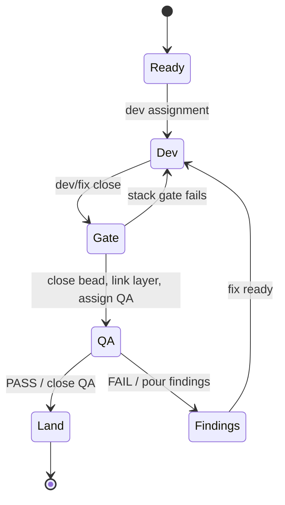

# Lite profile requirements

The lite profile runs development and QA without a sanity task. Every close
hook and cron tick checks `profile = "lite"` before side effects. State is
derived from beads, tasks, stack metadata, and PR state; no progress file is
maintained.

## Lifecycle

## Transitions

| Transition | Ordered effects | Replay observation |
| --- | --- | --- |
| Dev/fix close | validate vars, stack gate, close bead, link layer, assign QA, close task | bead status, stack layers, QA task, task status |
| QA PASS | close QA bead, notify lead, close task | bead status, notification receipt, task status |
| QA FAIL | pour findings, notify lead, close task | finding children, notification receipt, task status |
| Refused | reopen/update bead with reason, notify lead, close refused task | bead status/reason, notification receipt, task status |

Every gate or command error has an actionable fix. Retry is the same hook
command; the runner re-reads state and skips completed steps.

## Errors

| Kind | Meaning | Recovery |
| --- | --- | --- |
| `PROFILE_MISMATCH` | Phase is not lite | Invoke the profile-matched workflow. |
| `CONFIG_INVALID` | Phase or close vars are invalid | Repair input and retry. |
| `COMMAND_FAILED` / `TIMEOUT` | External operation failed | Repair the named command and retry. |
| `NOT_FOUND` | Required phase, bead, or PR was not found | Restore or correct the reference. |
| Stack result other than `Stacked` | PR does not satisfy stack ancestry | Rebase and push on current stack top. |
